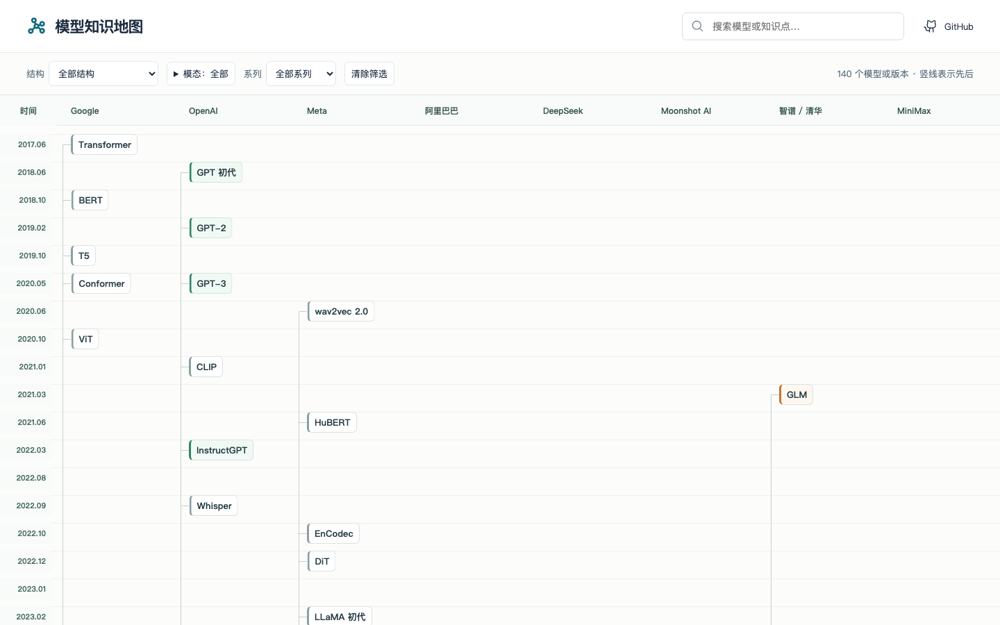
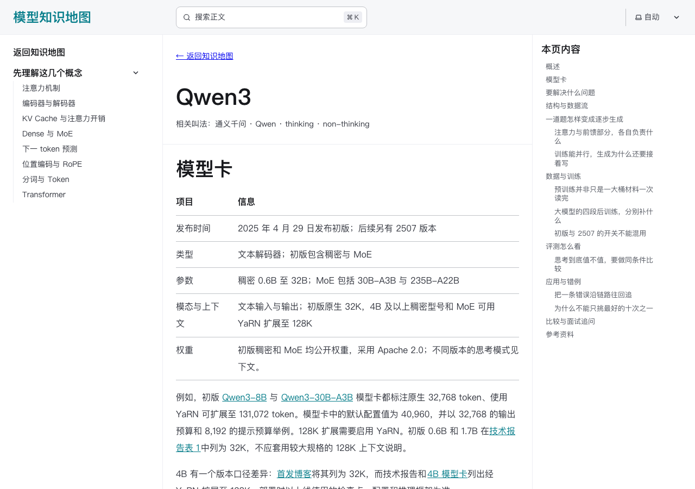

# 模型知识地图：从 Transformer 读懂 AI 模型

[](https://yunnglin.github.io/model-atlas-zh/)
[](https://model-atlas-zh.pages.dev/)
[](https://github.com/Yunnglin/model-atlas-zh/actions/workflows/verify.yml)
[](https://github.com/Yunnglin/model-atlas-zh/actions/workflows/deploy.yml)
[](https://github.com/Yunnglin/model-atlas-zh/stargazers)
[](LICENSE)
[](LICENSE-CONTENT.md)

**[打开在线知识地图 →](https://model-atlas-zh.pages.dev/)** · [GitHub Pages 入口](https://yunnglin.github.io/model-atlas-zh/)

一个中文 AI 模型学习知识库。沿时间线认识 BERT、GPT、Qwen、DeepSeek、Kimi、GLM 等模型，再走进模型页面，用大白话和例子理解它们的结构、训练、评测与应用。

**适合谁：**想系统学习大模型、多模态模型，或准备相关技术面试的读者。项目重点介绍开放权重模型；对于闭源模型，以公开资料为准说明已知能力和边界。

## 先看看长什么样

首页按厂商和时间排列模型，可以筛选或搜索：



进入模型页面，可以先看模型卡，再按目录阅读结构、训练、评测和应用：



## 能在这里学到什么

- **模型发展脉络**：从 Transformer 出发，按发布时间和厂商浏览模型；用结构、模态和系列筛选，或搜索模型名称与知识点。
- **模型原理**：走进模型的独立页面，结合架构图、例子和参考资料，学习结构、训练、评测和应用。覆盖 NLP、视觉、语音和多模态。
- **训练与推理方法**：学习 [SFT](src/content/docs/training/sft.md)、[LoRA](src/content/docs/training/lora.md)、[RLHF](src/content/docs/training/rlhf.md)、[RLVR](src/content/docs/training/rlvr.md)、[PPO](src/content/docs/training/ppo.md)、[GRPO](src/content/docs/training/grpo.md)、[GSPO](src/content/docs/training/gspo.md)、[DAPO](src/content/docs/training/dapo.md)、[DPO](src/content/docs/training/dpo.md)、[知识蒸馏](src/content/docs/training/distillation.md)和[量化](src/content/docs/training/quantization.md)，理解它们分别解决什么问题。
- **实践案例**：围绕数据、训练、评测、应用与错例分析梳理思路，并提供资料和工具入口。

如果这份地图对你的学习有帮助，欢迎给 [项目点个 Star](https://github.com/Yunnglin/model-atlas-zh)，也欢迎通过 Issue 提出问题或参与改进。

访问[在线知识地图](https://model-atlas-zh.pages.dev/)即可开始学习；也可以按下面的步骤在本地运行。

## 本地运行

准备 `.node-version` 指定的 Node 24，并使用项目固定的 pnpm：

```sh
corepack enable
pnpm install --frozen-lockfile
pnpm dev
```

打开终端输出的地址。其他项目占用默认端口时，Astro 会选择可用端口。

## 可以怎么学

1. 首页按厂商和年月浏览模型，选中节点查看关系，再进入正文。
2. 模型页按章节连贯讲解结构、数据与训练、评测和应用；目录可以直接跳到关心的位置。
3. 遇到不熟悉的概念，点击正文中的链接或页末的关联知识继续阅读；使用浏览器返回键回到原文。
4. 架构图结合官方原图与原创教学图，注明来源并提供原图入口；第三方交互图提供独立入口。
5. 返回地图继续浏览；搜索用于快速找模型、方法和别名。

厂商列中的竖线表示时间先后，不代表模型继承。选中节点后，可查看已记录的直接关系及其解释和资料；关系连线中的虚线表示比较。Qwen 覆盖一代至 3.8，以及 Audio／ASR、VL、Omni、TTS、Coder、Image、数学与检索等分支；Kimi 与 GLM 各有代际表和重点详解。各分支独立编号，不按主线版本号补造型号。

模型页分别说明已确认的开放权重、只公开报告与闭源服务。未公开的训练数据和结构不作推测。精选范围见 [内容清单](docs/content-scope.md)。

## 检查与构建

```sh
pnpm check
pnpm test
pnpm build
pnpm exec playwright install chromium
pnpm test:e2e
```

验证 GitHub Pages 子路径：

```sh
ATLAS_BASE=/model-atlas-zh/ pnpm build
ATLAS_BASE=/model-atlas-zh/ pnpm test:e2e
```

正文使用 Starlight 和 Pagefind。全文搜索需要构建后的索引，请在 `pnpm build` 后运行 `pnpm preview` 检查。地图节点搜索也支持中文别名。

## 项目边界

- 网站提供知识与可复现案例说明，不执行训练、评测或收费模型调用。
- 案例明确区分说明性方案与真实运行记录，当前没有宣称任何实测改进。
- 模型正文为独立静态页面；首页的概念阅读区使用 URL 保存查阅路径。首页不提供学习进度或自测。
- GitHub Pages 由 GitHub Actions 在验证通过后发布；Cloudflare Pages 目前通过本地构建后手动上传更新。

架构和依赖方向见 [架构说明](docs/architecture.md)，写作规范见 [内容指南](docs/content-guide.md)。欢迎通过 Issue 反馈不清楚的解释，贡献方式见 [CONTRIBUTING.md](CONTRIBUTING.md)。

## 许可

代码使用 [MIT](LICENSE)。原创知识正文、题目和整理数据使用 [CC BY 4.0](LICENSE-CONTENT.md)。链接指向的论文、代码和其他外部资料保留原作者的许可；本项目复用的 Whisper 与 SAM 官方图及许可分别保存在 `public/figures/whisper/`（MIT）和 `public/figures/sam/`（Apache-2.0）；来源见 [资产记录](docs/assets.md)。
